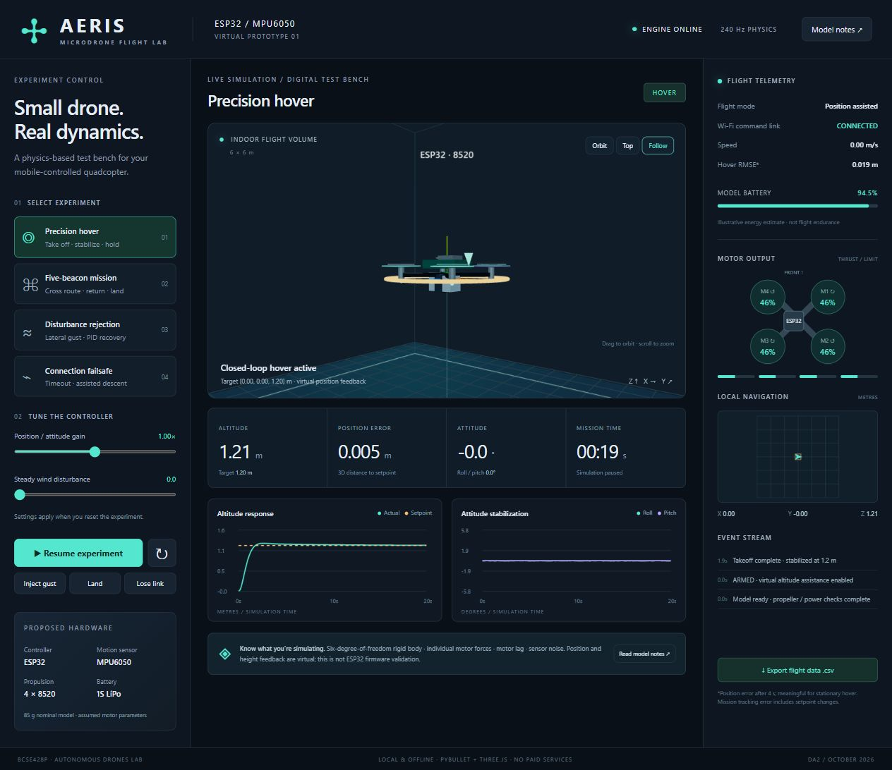

# AERIS - ESP32 Microdrone Flight Lab



A free, local 3D physics simulation built for the mobile-controlled ESP32 +
MPU6050 quadcopter proposal and BCSE428P Autonomous Drones Lab. No payment,
cloud service, account, GPU software or hardware purchases are needed.

## Get started on a friend's Windows computer

1. Download this repository using GitHub's **Code > Download ZIP**, then
   extract the entire ZIP into a writable folder.
2. Double-click **START_SIMULATION.cmd**. The first launch downloads the
   free physics environment; keep the launcher open and allow setup to finish.
3. Open **http://127.0.0.1:8765** in Chrome or Edge. If the page opened before
   setup finished, refresh it once the launcher says the flight lab is ready.
4. Choose an experiment and click **Run experiment**.

Windows 10/11 64-bit and internet access for initial setup are required.
The runtime is intentionally not included in this repository. Each computer
installs its own local environment. The localhost link works only after
starting the simulator on that computer; GitHub does not host the live Python
physics engine. After setup, the simulator can run offline.

## Open the simulation

Double-click **START_SIMULATION.cmd** in this folder. Keep its window open.
Open **http://127.0.0.1:8765** in a modern browser. The environment is already
installed on this computer. Internet is unnecessary after setup.

1. Select an experiment on the left.
2. Press **Run experiment**.
3. Try **Follow** for a close view of the physical-size microdrone, or **Top**
   for the navigation route. Drag the scene to orbit; scroll to zoom.
4. Watch motor outputs, altitude, attitude, events and local navigation.
5. Export the CSV for evidence. Reset before changing experiments or gains.

Space pauses/resumes. G injects a gust; L requests landing. Arrow keys nudge
the horizontal target by 0.25 m, as a desktop surrogate for mobile commands.
Use arrow commands in hover; the waypoint mission owns its own target.

The server binds only to this computer's loopback interface. A physical phone
connection is not implemented. The link-loss button tests controller timeout
logic, not Wi-Fi radio performance.

## Four experiments

| Experiment | What happens | Evidence |
|---|---|---|
| Precision hover | Ground takeoff to 1.2 m; hold with feedback | Altitude response, attitude, position RMSE |
| Five-beacon mission | Visit center, east, north, west, south; return home and land | 5/5 beacon events and touchdown |
| Disturbance rejection | Apply a 0.12 N / -0.055 N horizontal gust at 7 seconds for 1.2 seconds | Error excursion and recovery |
| Connection failsafe | Lose simulated commands at 9 seconds; wait 0.5 seconds; assisted landing | Link event, timeout event, touchdown |

To reproduce numerical checks, double-click **RUN_VALIDATION.cmd**.
`results/validation.json` contains actual computed results and acceptance
criteria are in `validate.py`. Each scenario also produces a full CSV.
Simulation time advances faster than real time in validation; the browser
uses real time. Seeds and time steps are fixed for repeatability.

## Relationship to the submitted proposal

The proposal defines ESP32 control and wireless commands, MPU6050 sensing,
four 8520 brushed motors, MOSFET drivers, 1S LiPo, a lightweight frame and
PID stabilization. The visual model depicts that architecture. The control
pipeline is:

Command / mission -> position PD + altitude PID -> attitude PD -> motor
allocation -> motor lag / saturation -> Bullet rigid-body physics -> feedback.

This is a physics/control prototype, **not ESP32 firmware emulation**.
The controller is Python, not deployed Arduino or ESP-IDF code.

### Honest sensor boundary

MPU6050 alone does not measure global position, height or absolute yaw.
Here, position/velocity feedback is obtained from virtual world state with
1 mm Gaussian position noise. Orientation feedback has 0.0007 rad Gaussian
noise; angular rates come from rigid-body state. This is an IMU-inspired
feedback approximation, not a full accelerometer/gyro model or sensor-fusion
implementation. No GPS satellite simulation is performed.

Autonomous navigation and assisted landing therefore extend the proposal
using virtual sensors. Do not claim that the proposed bare ESP32 + MPU6050
hardware can do these operations without additional sensing. No camera,
object recognition, search-and-rescue, or real network tests are implemented.

## Model assumptions (not measured component specifications)

| Parameter | Assumed value |
|---|---|
| Mass | 0.085 kg |
| Rotor offsets | x/y = +/-0.045 m (127 mm diagonal motor spacing) |
| Inertia xx, yy, zz | 0.000075, 0.000075, 0.00013 kg m2 |
| Maximum thrust per motor | 0.45 N |
| Motor lag | First-order, 25 ms |
| Yaw reaction torque / thrust | 0.006 m |
| Linear drag | 0.025 N per m/s |
| Gravity | 9.81 m/s2 |
| Physics / controller rate | 240 Hz |
| Nominal battery energy | 3.7 V x 0.5 Ah |

At nominal parameters total thrust/weight is about 2.16. This is an assumption
for a viable virtual design, not proof that Amazon motors deliver it.
The battery display integrates an illustrative electrical-power curve;
it does not model voltage sag, motor voltage dependence, discharge protection
or validated endurance. Floor contact uses a box collision body. The drawn
frame, guards, propellers and laboratory boundaries are visual; they have no
separate collision geometry. There is no aerodynamic ground-effect model.

### Control equations

Horizontal acceleration: a_xy = 1.7 g_p (p_target - p) - 2.3 v.
Vertical acceleration: a_z = 4.5 g_p e_z - 3.2 v_z + 0.5 integral(e_z).
The height integrator is clamped to +/-0.4 m s.
Tilt requests are limited to +/-0.30 rad. Desired roll/pitch are calculated
from acceleration in the current yaw frame. Collective force compensates for
tilt: F = m (9.81 + a_z) / max(0.75, cos(roll) cos(pitch)).
Attitude torque: tau = diag(0.007, 0.007, 0.004) g_p angle_error
- diag(0.0014, 0.0014, 0.0018) body_angular_rate.
The UI gain multiplier g_p changes proportional gains only.

Motor mixing solves [F, tau_x, tau_y, tau_z] = A f, with each column of A
equal to [1, y_i, -x_i, spin_i*0.006]. Motor force f_i is saturated to
[0, 0.45] N and passed through first-order lag. Each force acts along body
Z at its own arm position; Bullet integrates the resulting translation and
rotation. The controller never sets the body position during flight.

## Lab syllabus mapping

- Experiment 1: visual 3D frame, electronics, battery and four rotors.
- Experiments 2-4: feedback stabilization, hover and PID position control.
- Experiment 5: five beacons in a cross and position-based autopilot logic,
  using virtual local position instead of GPS.
- Experiments 6-7 (vision following and rescue): not implemented.

The lab PDF is a syllabus, not a DA2 marking rubric. Confirm assessment
expectations with the instructor. Present the simulator and its limitations
as engineering work; it does not establish physical hardware performance.

## Explain it during evaluation

“Our proposed hardware uses an ESP32, MPU6050 and four brushed motors. Before
buying hardware we built a physics-based virtual prototype to evaluate the
control architecture. Each motor applies a real force in the physics engine.
We can inspect hover stability, reject a disturbance, and test a command-loss
state machine. For the lab's navigation exercise, we added clearly labelled
virtual position and height feedback and validated a five-beacon mission.
The next hardware step is to measure motor thrust and total mass, then port
and tune the attitude controller on the ESP32.”

## Setup on another Windows computer

Use a modern browser with WebGL enabled. Double-click START_SIMULATION.cmd.
On a new machine, setup.ps1 downloads the free micromamba environment manager
and installs a local `.physics` environment from conda-forge. No system Python
or C++ compiler is required. Allow about 300 MB of downloads for first setup.
This does not modify your system Python. On this computer setup is complete.

Windows uses the prebuilt conda-forge PyBullet 3.25 package. Standard PyPI
PyBullet does not supply a current Windows wheel, so requirements.txt is
provided only as an alternative Linux setup, not the Windows installer.

If setup was interrupted, run setup.ps1 again. To start manually:

```powershell
$env:PATH = "$PWD/.physics;$PWD/.physics/Library/bin;" + $env:PATH
& .physics/python.exe server.py
```

If the port is occupied by another application:

```powershell
& .physics/python.exe server.py --port 8766
```

Then open http://127.0.0.1:8766. Do not open index.html directly; the Python
server supplies live physics state. Closing the launcher stops the engine.

## Free software and sources

- Bullet/PyBullet: https://github.com/bulletphysics/bullet3 (zlib license).
- Three.js 0.170.0: https://github.com/mrdoob/three.js/tree/r170 (MIT license).
- NumPy: https://numpy.org/ (BSD license).
- Original project code: MIT; see LICENSE.
- Third-party notices: web/vendor/THREE-LICENSE.txt and THIRD_PARTY.md.

Three.js is vendored locally; no CDN or remote fonts are used at runtime.
